  <picture>
    <source media="(prefers-color-scheme: dark)" srcset="https://raw.githubusercontent.com/Harry2876/Harry2876/main/header-dark.svg" />
    <source media="(prefers-color-scheme: light)" srcset="https://raw.githubusercontent.com/Harry2876/Harry2876/main/header-light.svg" />
    
  </picture>

  
  
  

  Computer Science (AI) student at Government Engineering College Lakhisarai, India 🇮🇳 
  I build backend systems, native Android apps, and real-time computer vision tools.

### Highlights

<table>
  <tr>
    <td width="120" align="center">
      
    </td>
    <td>
      <b>IndiaSkills, Mobile Application Development</b> 
      2025-26: Gold (Regional), Gold + Silver (National) 
      2024: Medallion of Excellence (National), Gold (State)
    </td>
  </tr>
  <tr>
    <td width="120" align="center">
      
    </td>
    <td>
      <b>NODWIN Gaming, BGMI Masters Series 2026</b> 
      Live production graphics for the Playoffs and Grand Finals, powered by a system I built that reads the live game feed and updates graphics in 1-2 seconds
    </td>
  </tr>
</table>

### Projects

Most of my work is private, and I'm happy to demo it on a call. The skiing game is public.

| Project | What it is | Stack |
| --- | --- | --- |
| **PT Maker** | Tournament management backend for BGMI: registrations, rosters, match scoring, standings, and an OCR-based result pipeline. Load-tested at 100 req/s | TypeScript, Node.js, PostgreSQL, Redis, BullMQ, Docker |
| **Scrymz Broadcast Platform** | Live esports broadcast pipeline that reads the game feed with computer vision and drives operator dashboards and on-air overlays | Python, YOLO, OpenCV, Node.js, Socket.IO, React |
| **Observer HUD** | Desktop app that processes live video and renders team-branded overlays | Electron, C++, OpenCV, NDI, ONNX Runtime |
| [**Skiing Game**](https://github.com/Harry2876/skiing_game) | Android skiing game for the IndiaSkills test module: tap to jump, collect coins, dodge obstacles, invincibility power-up, local leaderboard, music and sound effects | Kotlin, Jetpack Compose |

### Stack

  

### Activity

  <picture>
    <source media="(prefers-color-scheme: dark)" srcset="https://raw.githubusercontent.com/Harry2876/Harry2876/main/assets/stats-dark.svg" />
    <source media="(prefers-color-scheme: light)" srcset="https://raw.githubusercontent.com/Harry2876/Harry2876/main/assets/stats-light.svg" />
    
  </picture>

  <picture>
    <source media="(prefers-color-scheme: dark)" srcset="https://raw.githubusercontent.com/Harry2876/Harry2876/output/github-snake-dark.svg" />
    <source media="(prefers-color-scheme: light)" srcset="https://raw.githubusercontent.com/Harry2876/Harry2876/output/github-snake.svg" />
    
  </picture>

